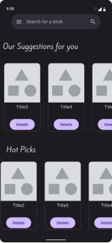
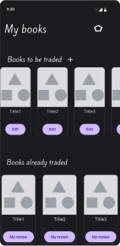
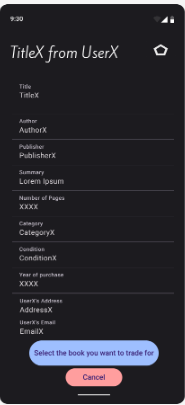
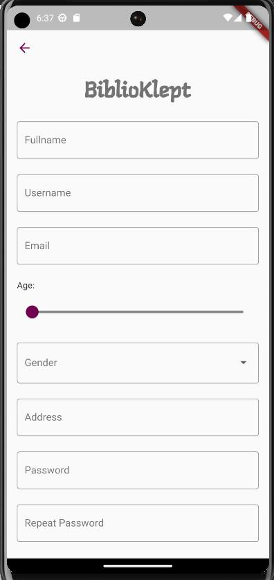
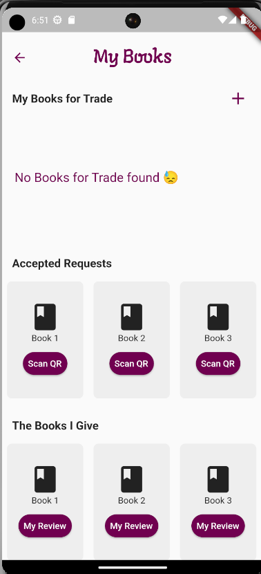
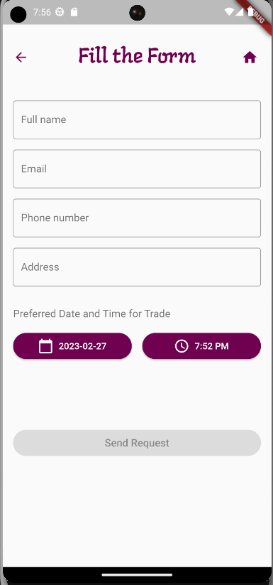
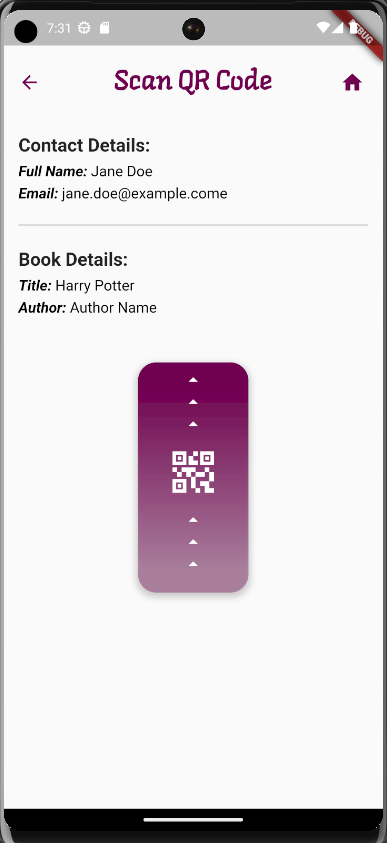

# BiblioKlept

### Discover books. Share your library. Arrange an exchange.

A book-exchange mobile application prototype built with **Flutter, Dart, and SQLite** for the **Human–Computer Interaction** course at the School of Electrical and Computer Engineering, National Technical University of Athens (NTUA), during the **2022–2023 fall semester**.

The project explores how readers can find books, offer their own titles, and coordinate exchanges through a mobile interface. It combines Figma interface design with a Flutter implementation and local data persistence.

**Academic team project · Group 99 · Local application prototype**

[Design previews](#design-previews) · [Flutter screenshots](#flutter-implementation) · [Getting started](#getting-started) · [Project report](docs/HCI-Biblioklept.pdf) · [Original repository](https://github.com/pGiad/BiblioKlept-NTUA)

## Design previews

Selected screens extracted from the team's second-stage Figma design sheet. These show the intended interface and sample content; they are **design mockups**, not screenshots of the running Flutter app.

<table>
  <tr>
    <th>Discover books</th>
    <th>Manage your library</th>
    <th>Explore book details</th>
  </tr>
  <tr>
    <td align="center"></td>
    <td align="center"></td>
    <td align="center"></td>
  </tr>
</table>

## Features and scope

- **Accounts and profiles:** sign-up, login, profile editing, and favorite-genre selection, backed by a local user database.
- **Personal book collection:** add, edit, and delete book records, including title, author, publisher, summary, category, condition, and purchase year.
- **Book discovery:** search stored books by title, author, category, or condition, and retrieve books by genre.
- **Exchange interfaces:** book selection, contact details, preferred meeting date and time, received requests, and approval/rejection interactions.
- **Camera and QR interfaces:** book-cover capture, QR generation, and a swipe-to-scan interaction.
- **Review interface:** a dedicated screen for feedback on an exchange.

The exchange, review, and QR screens demonstrate the intended user journeys. Some use sample data or incomplete logic; their presence does not imply a complete exchange service. See [Current limitations](#current-limitations).

## Flutter implementation

The following screenshots are extracted from the final project report and show the light-theme Flutter implementation. They retain the original emulator/debug indicators visible in the report.

<table>
  <tr>
    <th>Sign up</th>
    <th>My Books</th>
    <th>Arrange an exchange</th>
    <th>Scan a QR code</th>
  </tr>
  <tr>
    <td align="center"></td>
    <td align="center"></td>
    <td align="center"></td>
    <td align="center"></td>
  </tr>
</table>

## From Figma to Flutter

The final report documents changes made when translating the designs into an application:

| Design decision | Flutter implementation |
| --- | --- |
| Visual style | Light backgrounds and revised purple accents replaced the dark Figma palette. |
| Age entry | A slider replaced free-text input to constrain the available values. |
| Structured fields | Dropdowns replaced free-text entry for gender and book category, condition, and purchase year. |
| Navigation and feedback | Back navigation, an empty-library message, and request confirmation dialogs were added. |
| Exchange scheduling | Separate date and time pickers replaced the original date-only interaction. |
| QR scanning | A swipe-up control opens the scanner; the original post-scan success screen was omitted. |

See the [final report in Greek](docs/HCI-Biblioklept.pdf) for the full comparison and the [complete design sheet](docs/design/biblioklept-stage-2.png) for additional mockups.

## Technology

| Area | Tools |
| --- | --- |
| Interface design | Figma |
| Application | Flutter and Dart |
| Local persistence | SQLite through `sqflite`; database paths through `path` |
| Camera | `camera` |
| QR codes | `qr_flutter`, `flutter_barcode_scanner`, `mobile_scanner` |
| Additional dependencies | `gallery_saver`, `intl` |

User and book models, along with database operations, are defined in [`biblioklept/lib/main.dart`](biblioklept/lib/main.dart). Individual Dart files implement the application's screens. Data is stored in the local `biblioklept.db` database, with books associated with users through `userID`.

## Getting started

### Prerequisites

- A Flutter SDK whose bundled Dart version satisfies **`>=2.18.4 <3.0.0`**, as specified in the original `pubspec.yaml`.
- Android SDK tooling and an Android device or emulator.
- Camera access for camera and QR-scanning interactions.

This is a 2022–2023 project. Its dependencies and Android build configuration may require migration for newer toolchains. A fresh build has not been verified as part of this documentation update. Android is the target described by the original build instructions; other generated platform folders do not establish tested support.

### Run the application

Clone this repository:

```bash
git clone https://github.com/johnskop7/biblioklept-flutter.git
cd biblioklept-flutter/biblioklept
flutter pub get
flutter run
```

Run Flutter commands from `biblioklept/`, where `pubspec.yaml` is located. Ensure `android/local.properties` points to your own Android and Flutter SDK installations; the original repository tracks a machine-specific copy.

### Build an Android debug APK

```bash
flutter build apk --debug
```

The generated APK is placed at `biblioklept/build/app/outputs/flutter-apk/app-debug.apk`, relative to the repository root.

## Current limitations

- **Local data only:** users and books are stored on one device. No shared server or cross-device synchronization is implemented.
- **Prototype exchange flows:** some request, contact, and review screens contain demonstration content rather than complete persistent workflows.
- **Partial QR workflow:** generated codes encode a timestamp; saving the generated image is unfinished, and scanning does not populate the displayed sample book/contact details.
- **Demo account handling:** passwords are stored as plain text in the local database. Use fictional credentials and sample personal details.
- **Legacy verification:** the repository includes the default Flutter counter test, which does not validate this application. Build compatibility and application behavior need fresh verification before further development.

## Team and attribution

Developed collaboratively by **Group 99** for Human–Computer Interaction at ECE NTUA:

| Team member | GitHub |
| --- | --- |
| Michael Angelos Velalopoulos | [MichaelangeloVelalopoulos](https://github.com/MichaelangeloVelalopoulos) |
| Panagiotis Giadikiaroglou | [pGiad](https://github.com/pGiad) |
| Ioannis Litsos | [johnskop7](https://github.com/johnskop7) |

**Ioannis Litsos's contribution:** the commit history records work on book details and selection, trade contact details, received-request and request-information screens, QR-related interfaces, saved-code and book-search screens, camera integration, and navigation/UI changes. These contributions form part of the team's shared implementation.

The [original repository](https://github.com/pGiad/BiblioKlept-NTUA) preserves the development history and individual commits. The report, design mockups, and application are credited to the project team. No project-wide license is included in the original repository.
